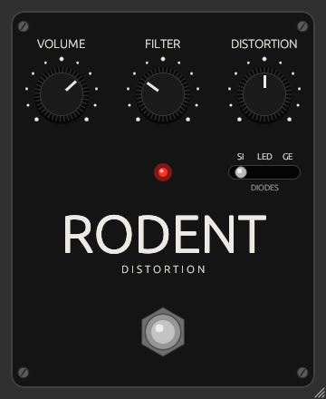

# Rodent

[](https://github.com/accraze/rodent/actions/workflows/ci.yml)

A ProCo RAT style distortion plugin (CLAP / VST3) built with [nih-plug](https://github.com/robbert-vdh/nih-plug).

<p align="center"></p>

Each stage of the original circuit is modelled: the LM308 gain stage (including its
bandwidth and slew-rate limits), the diode clipper, and the passive filter.
The non-linear part runs at 4x oversampling.

| Control    | Range                                          |
|------------|------------------------------------------------|
| Volume     | −30 to +12 dB                                  |
| Filter     | 0–100% (clockwise = darker, ~32 kHz → 475 Hz)  |
| Distortion | 0–100% (audio taper, up to ~66 dB)             |
| Diodes     | SI (stock 1N914), LED (Turbo RAT), GE (You Dirty Rat) |
| Footswitch | Bypass (the LED is lit when the effect is on)  |

Knobs: drag or scroll to turn, hold Shift for fine control, double-click to reset.
Drag the bottom-right corner to resize the window.

## Build

Needs a recent Rust from [rustup](https://rustup.rs) (distro packages are usually too old).
The GUI (egui) also needs X11/GL headers:

```sh
sudo apt install libx11-xcb-dev libxcb1-dev libxcb-dri2-0-dev libxcb-icccm4-dev libxcursor-dev libxkbcommon-dev libxcb-shape0-dev libxcb-xfixes0-dev libgl-dev
```

```sh
cargo xtask bundle rodent --release
cargo test --lib
```

Bundles land in `target/bundled/`.

## Install (Linux)

Grab `rodent-<version>-linux.zip` from [Releases](https://github.com/accraze/rodent/releases) and unzip it, or build it yourself. Then:

```sh
cp target/bundled/Rodent.clap ~/.clap/
cp -r target/bundled/Rodent.vst3 ~/.vst3/   # optional
```

Then rescan plug-ins in your DAW.

## License

Rodent is licensed under the [GNU General Public License v3.0 or later](LICENSE).
nih-plug itself is ISC licensed, but its VST3 bindings are GPLv3, so VST3 builds must be GPL anyway.
